<p align="center">
  
</p>

<p align="center">
  Developer at Devoli. I turn half-formed ideas into things people can click,<br>
  mostly in React and Node, with a few years of PHP and Laravel behind me.
</p>

<p align="center">
  <a href="https://ahamedr.vercel.app">website</a> &nbsp;·&nbsp;
  <a href="https://twitter.com/Ahamed__r">x</a> &nbsp;·&nbsp;
  <a href="https://www.linkedin.com/in/ahamed-rasheed/">linkedin</a> &nbsp;·&nbsp;
  <a href="https://stackoverflow.com/users/8009816/ahamed-rasheed">stack overflow</a>
</p>

<p align="center"><sub>Drag to spin the A.</sub></p>

```stl
solid ahamed
facet normal 0.0000 0.0000 -1.0000
 outer loop
  vertex -6.605 -0.718 -3.000
  vertex -2.395 30.718 -3.000
  vertex 2.395 29.282 -3.000
 endloop
endfacet
facet normal 0.0000 0.0000 -1.0000
 outer loop
  vertex -6.605 -0.718 -3.000
  vertex -11.395 0.718 -3.000
  vertex -2.395 30.718 -3.000
 endloop
endfacet
facet normal 0.0000 0.0000 1.0000
 outer loop
  vertex -6.605 -0.718 3.000
  vertex 2.395 29.282 3.000
  vertex -2.395 30.718 3.000
 endloop
endfacet
facet normal 0.0000 -0.0000 1.0000
 outer loop
  vertex -6.605 -0.718 3.000
  vertex -2.395 30.718 3.000
  vertex -11.395 0.718 3.000
 endloop
endfacet
facet normal 0.9578 -0.2873 0.0000
 outer loop
  vertex -6.605 -0.718 -3.000
  vertex 2.395 29.282 -3.000
  vertex 2.395 29.282 3.000
 endloop
endfacet
facet normal 0.9578 -0.2873 0.0000
 outer loop
  vertex -6.605 -0.718 -3.000
  vertex 2.395 29.282 3.000
  vertex -6.605 -0.718 3.000
 endloop
endfacet
facet normal 0.2873 0.9578 0.0000
 outer loop
  vertex 2.395 29.282 -3.000
  vertex -2.395 30.718 -3.000
  vertex -2.395 30.718 3.000
 endloop
endfacet
facet normal 0.2873 0.9578 -0.0000
 outer loop
  vertex 2.395 29.282 -3.000
  vertex -2.395 30.718 3.000
  vertex 2.395 29.282 3.000
 endloop
endfacet
facet normal -0.9578 0.2873 0.0000
 outer loop
  vertex -2.395 30.718 -3.000
  vertex -11.395 0.718 -3.000
  vertex -11.395 0.718 3.000
 endloop
endfacet
facet normal -0.9578 0.2873 0.0000
 outer loop
  vertex -2.395 30.718 -3.000
  vertex -11.395 0.718 3.000
  vertex -2.395 30.718 3.000
 endloop
endfacet
facet normal -0.2873 -0.9578 0.0000
 outer loop
  vertex -11.395 0.718 -3.000
  vertex -6.605 -0.718 -3.000
  vertex -6.605 -0.718 3.000
 endloop
endfacet
facet normal -0.2873 -0.9578 0.0000
 outer loop
  vertex -11.395 0.718 -3.000
  vertex -6.605 -0.718 3.000
  vertex -11.395 0.718 3.000
 endloop
endfacet
facet normal 0.0000 0.0000 -1.0000
 outer loop
  vertex 11.395 0.718 -3.000
  vertex -2.395 29.282 -3.000
  vertex 2.395 30.718 -3.000
 endloop
endfacet
facet normal -0.0000 0.0000 -1.0000
 outer loop
  vertex 11.395 0.718 -3.000
  vertex 6.605 -0.718 -3.000
  vertex -2.395 29.282 -3.000
 endloop
endfacet
facet normal 0.0000 0.0000 1.0000
 outer loop
  vertex 11.395 0.718 3.000
  vertex 2.395 30.718 3.000
  vertex -2.395 29.282 3.000
 endloop
endfacet
facet normal 0.0000 0.0000 1.0000
 outer loop
  vertex 11.395 0.718 3.000
  vertex -2.395 29.282 3.000
  vertex 6.605 -0.718 3.000
 endloop
endfacet
facet normal 0.9578 0.2873 0.0000
 outer loop
  vertex 11.395 0.718 -3.000
  vertex 2.395 30.718 -3.000
  vertex 2.395 30.718 3.000
 endloop
endfacet
facet normal 0.9578 0.2873 -0.0000
 outer loop
  vertex 11.395 0.718 -3.000
  vertex 2.395 30.718 3.000
  vertex 11.395 0.718 3.000
 endloop
endfacet
facet normal -0.2873 0.9578 0.0000
 outer loop
  vertex 2.395 30.718 -3.000
  vertex -2.395 29.282 -3.000
  vertex -2.395 29.282 3.000
 endloop
endfacet
facet normal -0.2873 0.9578 0.0000
 outer loop
  vertex 2.395 30.718 -3.000
  vertex -2.395 29.282 3.000
  vertex 2.395 30.718 3.000
 endloop
endfacet
facet normal -0.9578 -0.2873 0.0000
 outer loop
  vertex -2.395 29.282 -3.000
  vertex 6.605 -0.718 -3.000
  vertex 6.605 -0.718 3.000
 endloop
endfacet
facet normal -0.9578 -0.2873 0.0000
 outer loop
  vertex -2.395 29.282 -3.000
  vertex 6.605 -0.718 3.000
  vertex -2.395 29.282 3.000
 endloop
endfacet
facet normal 0.2873 -0.9578 0.0000
 outer loop
  vertex 6.605 -0.718 -3.000
  vertex 11.395 0.718 -3.000
  vertex 11.395 0.718 3.000
 endloop
endfacet
facet normal 0.2873 -0.9578 0.0000
 outer loop
  vertex 6.605 -0.718 -3.000
  vertex 11.395 0.718 3.000
  vertex 6.605 -0.718 3.000
 endloop
endfacet
facet normal 0.0000 0.0000 -1.0000
 outer loop
  vertex -5.500 9.000 -3.000
  vertex 5.500 13.000 -3.000
  vertex 5.500 9.000 -3.000
 endloop
endfacet
facet normal 0.0000 0.0000 -1.0000
 outer loop
  vertex -5.500 9.000 -3.000
  vertex -5.500 13.000 -3.000
  vertex 5.500 13.000 -3.000
 endloop
endfacet
facet normal 0.0000 0.0000 1.0000
 outer loop
  vertex -5.500 9.000 3.000
  vertex 5.500 9.000 3.000
  vertex 5.500 13.000 3.000
 endloop
endfacet
facet normal 0.0000 0.0000 1.0000
 outer loop
  vertex -5.500 9.000 3.000
  vertex 5.500 13.000 3.000
  vertex -5.500 13.000 3.000
 endloop
endfacet
facet normal 0.0000 -1.0000 0.0000
 outer loop
  vertex -5.500 9.000 -3.000
  vertex 5.500 9.000 -3.000
  vertex 5.500 9.000 3.000
 endloop
endfacet
facet normal 0.0000 -1.0000 0.0000
 outer loop
  vertex -5.500 9.000 -3.000
  vertex 5.500 9.000 3.000
  vertex -5.500 9.000 3.000
 endloop
endfacet
facet normal 1.0000 0.0000 0.0000
 outer loop
  vertex 5.500 9.000 -3.000
  vertex 5.500 13.000 -3.000
  vertex 5.500 13.000 3.000
 endloop
endfacet
facet normal 1.0000 0.0000 0.0000
 outer loop
  vertex 5.500 9.000 -3.000
  vertex 5.500 13.000 3.000
  vertex 5.500 9.000 3.000
 endloop
endfacet
facet normal 0.0000 1.0000 0.0000
 outer loop
  vertex 5.500 13.000 -3.000
  vertex -5.500 13.000 -3.000
  vertex -5.500 13.000 3.000
 endloop
endfacet
facet normal 0.0000 1.0000 -0.0000
 outer loop
  vertex 5.500 13.000 -3.000
  vertex -5.500 13.000 3.000
  vertex 5.500 13.000 3.000
 endloop
endfacet
facet normal -1.0000 0.0000 0.0000
 outer loop
  vertex -5.500 13.000 -3.000
  vertex -5.500 9.000 -3.000
  vertex -5.500 9.000 3.000
 endloop
endfacet
facet normal -1.0000 0.0000 0.0000
 outer loop
  vertex -5.500 13.000 -3.000
  vertex -5.500 9.000 3.000
  vertex -5.500 13.000 3.000
 endloop
endfacet
endsolid ahamed
```
